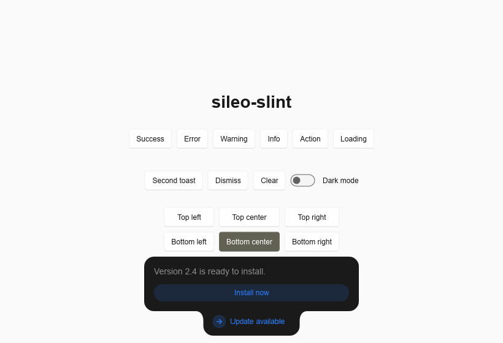

# sileo-slint

A physics-based toast component for [Slint](https://slint.dev), with a Rust API.
Port of [Sileo](https://github.com/hiaaryan/sileo) for React.



A toast is a small pill. When it has something more to say, a body grows out of the pill
with a spring and the two melt into one shape. Showing a new toast morphs the one that is
already there instead of piling up.

## Install

sileo-slint needs Slint 1.18 or newer. Add the crate twice: your code uses it, and so
does your build script.

```toml
[dependencies]
slint = "1.18"
sileo-slint = "0.1"

[build-dependencies]
slint-build = "1.18"
sileo-slint = "0.1"
```

The crate has no dependencies of its own, so the second entry costs nothing.

## Setup

`build.rs`: tell the Slint compiler where the component is.

```rust
fn main() {
    let config = slint_build::CompilerConfiguration::new()
        .with_library_paths(sileo_slint::library_paths());
    slint_build::compile_with_config("ui/app.slint", config).unwrap();
}
```

`ui/app.slint`: put one `Toaster` over your content.

```slint
import { Sileo, SileoItem, SileoKind, SileoPosition, SileoToast, Toaster } from "@sileo";
// Rust needs these types, so export them from your main file.
export { Sileo, SileoItem, SileoKind, SileoPosition, SileoToast }

export component App inherits Window {
    // your content first, the Toaster last so it is drawn on top
    Toaster { }
}
```

`src/main.rs`: connect the toast list once per window.

```rust
slint::include_modules!();

fn main() -> Result<(), slint::PlatformError> {
    let ui = App::new()?;
    sileo_slint::init!(ui);
    ui.run()
}
```

## Showing toasts

From Rust:

```rust
let sileo = ui.global::<Sileo>();

sileo.invoke_success("Saved".into(), "Your changes are stored.".into());

sileo.invoke_show(SileoToast {
    title: "Update available".into(),
    description: "Version 2.4 is ready to install.".into(),
    kind: SileoKind::Action,
    button: "Install now".into(),
    ..Default::default()
});

sileo.on_button_clicked(|id| println!("button of toast {id} clicked"));
```

From Slint, the same calls:

```slint
Button {
    text: "Save";
    clicked => { Sileo.success("Saved", "Your changes are stored."); }
}
```

### One toast that morphs

Every toast has an id. Showing a toast with the id of a visible toast morphs that toast.
Without an id, all toasts share one, so by default there is a single toast that changes
its content. Give toasts their own ids to stack them.

That is also how a progress toast works: show a loading toast, then show the result with
the same id.

```rust
let id = sileo.invoke_loading("Uploading".into());
// ... later, when the work is done:
sileo.invoke_show(SileoToast {
    id,
    title: "Upload complete".into(),
    ..Default::default()
});
```

### Behaviour

- A toast with a description or a button expands shortly after it appears and collapses
  again before it leaves. Set `no-autopilot` to expand on hover only.
- Hovering a toast expands it and pauses the timers of all toasts.
- Swiping a toast up or down by more than 30 px dismisses it.
- Only one toast is expanded at a time: the hovered one, else the newest one.

## Reference

### `Sileo`

| Member | What it does |
| --- | --- |
| `show(SileoToast) -> string` | Shows a toast, returns its id. |
| `success(title, description) -> string` | Shortcut for `show`. Also `error`, `warning`, `info`. |
| `loading(title) -> string` | A loading toast that stays until it is dismissed or shown again. |
| `dismiss(id)` | Plays the exit animation, then removes the toast. |
| `clear()` | Removes all toasts at once. |
| `button-clicked(id)` | Callback: the button of a toast was clicked. |

The remaining properties of `Sileo` are internal.

### `SileoToast`

Every field is optional. A zero value means "use the default".

| Field | Type | Default |
| --- | --- | --- |
| `id` | `string` | `"sileo-default"` |
| `title` | `string` | The name of the kind |
| `description` | `string` | None |
| `kind` | `SileoKind` | `success`. Others: `loading`, `error`, `warning`, `info`, `action` |
| `position` | `SileoPosition` | The position of the `Toaster` |
| `duration` | `duration` | The duration of the `Toaster` |
| `persistent` | `bool` | `false`. Stays until dismissed |
| `icon` | `image` | The icon of the kind |
| `fill` | `color` | The fill of the theme |
| `roundness` | `length` | The roundness of the `Toaster` |
| `no-autopilot` | `bool` | `false` |
| `button` | `string` | No button |

### `Toaster`

| Property | Type | Default |
| --- | --- | --- |
| `position` | `SileoPosition` | `top-right`. Also `top-left`, `top-center`, `bottom-left`, `bottom-center`, `bottom-right` |
| `theme` | `SileoTheme` | `system`: a dark toast on a light app and the reverse. `light` and `dark` name the app theme |
| `duration` | `duration` | `6s` |
| `roundness` | `length` | `16px` |
| `offset` | `length` | `12px`, the distance to the edges |
| `gap` | `length` | `12px`, the distance between stacked toasts |

The `Toaster` fills its parent and lets clicks through everywhere but on a toast. To keep
toasts out of a title bar or a side panel, give the `Toaster` its own `x`, `y`, `width`
and `height`.

## Differences from the original

- The shape is drawn as one path. The original blurs two rectangles together with an
  SVG filter, which Slint does not have. At rest both look the same, in motion the
  original is a little softer.
- A new header fades in after the old one has faded out, where the original blurs one
  into the other.
- There is no `promise` helper. Show a toast with the same id again (see above).
- The description is text and the icon is an image. Slint cannot pass components in data.
- There are no style class overrides. Use `fill` and `roundness`.
- Titles are shown as written, not capitalized.
- A toast is always 350 px wide.

## Demo

```bash
cargo run --example demo
```

`cargo run --example demo -- <dir>` walks through all states on its own, clicks, hovers
and swipes with synthetic pointer events, and writes frames as PNG into `<dir>`. Use it to
check a change to the toast by eye.

## Without Rust

The component is plain Slint in the [`ui`](ui) folder. The `init!` macro only keeps the
toast list: it handles `show`, `dismiss` and `clear` and fills `Sileo.items`,
`Sileo.items-reversed` and `Sileo.latest-id`. Another language can back the list in the
same way, [`src/lib.rs`](src/lib.rs) is the reference.

## Releasing

1. Set the new version in `Cargo.toml`.
2. In `CHANGELOG.md`, rename `Unreleased` to the version with today's date and add an
   empty `Unreleased` section above it.
3. Commit, then tag the commit `v<version>` and push the tag.

The release workflow checks that the tag matches `Cargo.toml`, publishes the crate and
creates a GitHub release with that section of the changelog. It needs a
`CARGO_REGISTRY_TOKEN` secret in the repository.

## License

MIT, see [LICENSE](LICENSE). The design, the behaviour and the icons come from
[Sileo](https://github.com/hiaaryan/sileo) by Aaryan, which is MIT licensed as well.
The icons are from [Lucide](https://lucide.dev) (ISC).
